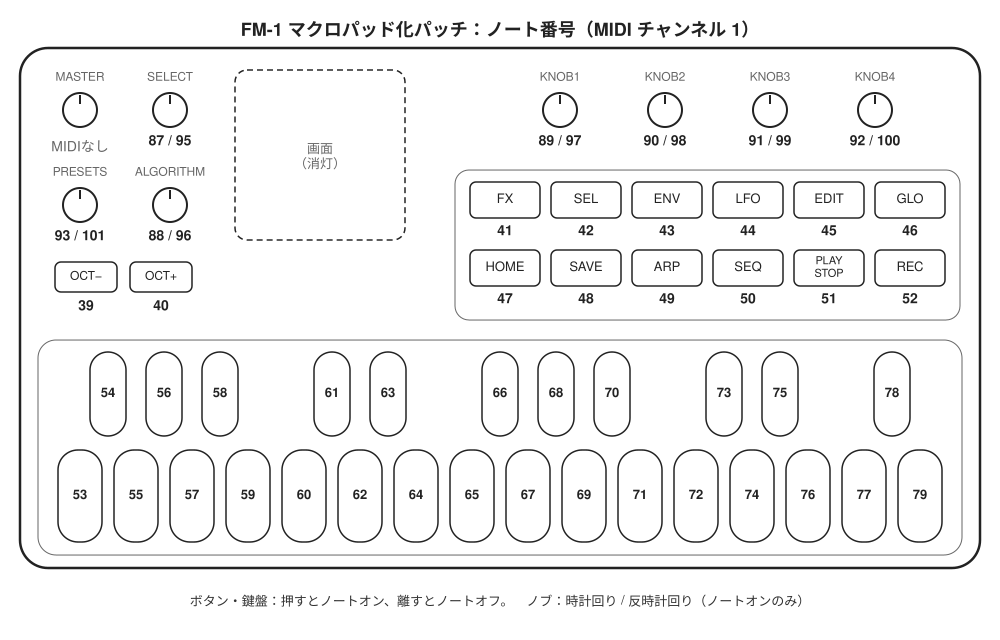

[English](README.md) | 日本語

# FM-1 マクロパッド化パッチ（非公式）

M-VAVE FM-1 の公式ファームウェア V15 に当てる非公式パッチ。
ボタン・鍵盤・ノブのすべてを USB-MIDI のノートとして送るようにして、
Keyboard Maestro や BetterTouchTool からショートカットを割り当てられる左手デバイス（マクロパッド）にする。

**このリポジトリには M-VAVE のファームウェアは入っていない。** 公式サイトから自分で入手した
`FM-1.fwsc`（V15）に、手元でパッチを当てて使う。

> **非公式の改造で、M-VAVE とは関係がない。** M-VAVE の承認も支援も受けていない。
> M-VAVE と FM-1 は各権利者の商標または製品名である。**このリポジトリに M-VAVE のファームウェアは入っていない。**

> **自己責任で使うこと。** 改造したファームウェアを書き込むと、メーカー保証を受けられなくなる場合がある。
> 書き込みに失敗すると、最悪の場合は本体が使えなくなる（この機種の復旧方法は確立していない）。
> このソフトウェアは無保証で、使用によって生じた損害について作者は責任を負わない。
> 書き込みの前に [docs/FLASHING.md](docs/FLASHING.md) の注意を読むこと。

## できること

| 入力 | 数 | 送るノート（チャンネル 1） |
|---|---|---|
| ボタン | 14 | 39〜52 |
| 鍵盤 | 27 | 53〜79（公式と同じ） |
| ノブ 時計回り | 7 | 87〜93 |
| ノブ 反時計回り | 7 | 95〜101 |

- 合計 55 入力。ボタンと鍵盤は押すとノートオン、離すとノートオフ。ノブは 1 クリックごとにノートオンだけを送る
- ノートオンのベロシティは本体の設定値をそのまま使う（作者の個体では 1）。ノートオフは 100
- 改造後は設定画面に入れないので、ベロシティを変えたい場合は書き込む前に公式ファームウェアで設定しておく
- LED はすべて消える。画面も点けない
- 対応表は [docs/NOTE_MAP.md](docs/NOTE_MAP.md)



## ショートカットを割り当てるアプリの例

FM-1 は MIDI のノートを送るだけなので、受け取ってショートカットに変えるアプリが別に要る。

| アプリ | OS | 価格 | 備考 |
|---|---|---|---|
| [Keyboard Maestro](https://www.keyboardmaestro.com/) | macOS | 有料 | MIDI のノートをトリガーにできる |
| [BetterTouchTool](https://folivora.ai/) | macOS | 有料 | MIDI のノートをトリガーにできる |
| [MidiKey2Key](https://midikey2key.de/) | Windows | 無料（寄付制） | MIDI を受けてキー操作やプログラムの起動を行う |
| [Bome MIDI Translator Pro](https://www.bome.com/products/miditranslator) | Windows / macOS | 有料（試用版あり） | 条件分岐やレイヤーなど機能が多い |

- 使うノート番号は上の「できること」の表と [docs/NOTE_MAP.md](docs/NOTE_MAP.md) を参照
- ノートオンのベロシティが 1 でも反応するかはアプリの設定による。「ベロシティを問わない」設定にしておくとよい

## 失うもの

- シンセサイザーとしての操作（音色の選択・編集、シーケンサー、アルペジエーターなど）はすべて使えなくなる
- 公式ファームウェアを書き戻せば元に戻る（[docs/FLASHING.md](docs/FLASHING.md)）

## 必要なもの

- M-VAVE FM-1 本体
- 公式ファームウェア V15：M-VAVE の Downloads ページにある `FM-1.fwsc`
  - SHA-256 が `db1642b2b6fa5c2cccb11ffd13878068bb28601678d3644049f99dc40e7edb8a` のものだけを受け付ける。M-VAVE がこのファイルを差し替えると、パッチャーは使えなくなる
- 公式の書き込みアプリ M-UPGRADE（Windows / macOS。M-VAVE の Downloads ページにある汎用版）
- パッチを当てるには、ブラウザ（Chrome・Edge・Safari など）か Python 3.9 以上のどちらか

## 使い方

### 1. パッチを当てる（ブラウザ・おすすめ）

1. パッチャーのページ <https://smememe.github.io/fm1-macropad-patch/> を開く
2. `FM-1.fwsc` をページにドラッグするか、「ファイルを選ぶ」で選ぶ
3. 「公式 V15 であることを確認しました」「書き換える 16 か所がすべて一致しました」と出たら、
   「FM-1-macropad.fwsc をダウンロード」を押す

処理はすべてブラウザの中で行い、ファイルはどこにも送らない（ページは通信を禁止する設定にしてある）。
このリポジトリを zip でダウンロードし、`docs/index.html` をダブルクリックで開いても同じように使える（ネット接続は不要）。

### 1'. パッチを当てる（Python）

ソースを読んで確かめたい人向け。`FM-1.fwsc` を `fm1patch.py` と同じフォルダに置き、そのフォルダで次を実行する。
Windows では `python3` の代わりに `py` を使う。

```bash
python3 fm1patch.py FM-1.fwsc -o FM-1-macropad.fwsc
```

どちらの方法も、公式ファームウェアの SHA-256 と、書き換える 16 か所の元のバイトを確かめてから書き換える。
どれか一つでも合わなければ何も出力しない。出力の SHA-256 は必ず
`4192103baeef0b4601a60e0ec55cd517371ec9834ce2e6b2964647e22aa98641` になる。

### 2. 書き込む

1. M-UPGRADE を起動し、本体を USB でつなぐ。本体が FM-1 として表示されることを確かめる（本体の今の版数は問わない）
2. 「Select Firmware」で `FM-1-macropad.fwsc` を選ぶ。「Firmware version:51」と表示される
3. 「Update Firmware」を押し、完了の表示が出るまで待つ（20〜60 秒ほど）。本体は自動で再起動する
4. ショートカット用のアプリ（下の「ショートカットを割り当てるアプリの例」）で鍵盤一つにショートカットを割り当て、押して動くことを確かめる

仮想環境（Parallels など）の Windows で書き込む場合は、途中で本体が別の USB 機器として接続し直す。
接続先を聞かれたら Windows を選び、続けて接続の許可を求められたら許可する。

## 元に戻す

M-UPGRADE で公式の `FM-1.fwsc` を書き込めば元に戻る。

## 困ったとき

- **パッチャーが SHA-256 の不一致で止まる**：入力が公式 V15 の `FM-1.fwsc` ではない。M-VAVE が配布ファイルを差し替えた場合もこうなる。その場合は Issues で知らせてほしい
- **M-UPGRADE が本体を見つけない**：USB ケーブルを挿し直し、M-UPGRADE を起動し直す。ほかの MIDI アプリが本体をつかんでいれば閉じる
- **「A firmware that does not conform to the device was selected」と出る**：ファイルが選ばれていないか、FM-1 用でない。パッチャーが作った `.fwsc` を選び直す
- **書き込みが途中で止まった**：USB をつないだまま本体の電源を入れ直し、M-UPGRADE でもう一度書き込みを試す（作者は途中で止まった場合を試していない）
- **ショートカットが動かない**：MIDI モニター（届いた MIDI を一覧で見るだけのアプリ。macOS は [MIDI Monitor](https://www.snoize.com/midimonitor/)、Windows は [MIDI-OX](http://www.midiox.com/) など）で、本体からノートが届いているか確かめる。
  届いていればショートカット側のアプリの設定（ベロシティ条件など）を見直す。届いていなければ本体側（書き込み・接続）を疑う
- **元に戻したい**：M-UPGRADE で公式の `FM-1.fwsc` を書き込む

## サポート

不具合の報告は [Issues](../../issues) で受け付ける。ただし個人の趣味のプロジェクトなので、返信や修正は約束できない。

## 確認した環境

| 項目 | 内容 |
|---|---|
| ファームウェア | 公式 V15（`FM-1_015`） |
| 書き込み | M-UPGRADE macOS 版（2026-09-08 配布）／Windows 版（Parallels 上の Windows 11 ARM 版） |
| 確かめたこと | 改造版の書き込み、公式への書き戻し（macOS）、全 55 入力のノート、LED の全消灯、Keyboard Maestro での受信 |
| パッチャー | ブラウザ版：Chromium 系・Safari（macOS）・Edge（Windows 11）、保存した HTML を開く使い方で、出力が期待どおりになることを確認。Python 版：macOS の Python 3.14 |
| 確かめていないこと | x64 の Windows PC での書き込み、Windows での書き戻し |

## 仕組み

書き換えはすべて等長で、ファームウェアの大きさは変わらない。app 領域の 16 か所、合計 84 バイトを書き換え、
版数文字列と EQ の名前の余白 1 バイトを変えて、チェックサムを付け直す。一覧は [docs/PATCHES.md](docs/PATCHES.md)、解析の要点は [docs/HOW_IT_WORKS.md](docs/HOW_IT_WORKS.md)（docs/ の資料は英語のみ）。

## 開発する人へ

- 書き換えの一覧は `fm1patch.py` にある。ブラウザ版（`docs/index.html`）は `web/src/` から作る：
  `python3 web/export_patches.py && python3 web/build_web.py`
- テストには公式の `FM-1.fwsc` が要る：`FM1_FWSC=/path/to/FM-1.fwsc python3 tests/test_patch.py` と
  `node tests/test_web.cjs /path/to/FM-1.fwsc`

## 謝辞

- [AL-255/FM-1-RE](https://github.com/AL-255/FM-1-RE)：ファームウェアの構造と書き込みプロトコルの解析。この改造の出発点
- [kagaimiq/jl-misctools](https://github.com/kagaimiq/jl-misctools)：JieLi のファームウェア形式の CRC と暗号処理（MIT。`jltech/` に一部を同梱）

## ライセンス

- このリポジトリで作者が書いた部分は [MIT License](LICENSE)
- 同梱物のライセンスは [THIRD_PARTY.md](THIRD_PARTY.md)
- **M-VAVE のファームウェアと、[docs/PATCHES.md](docs/PATCHES.md) に照合用として載せた元のバイト列は M-VAVE（または各権利者）のものであり、MIT License の対象外である**
- M-VAVE および FM-1 は、各権利者の商標または製品名である
