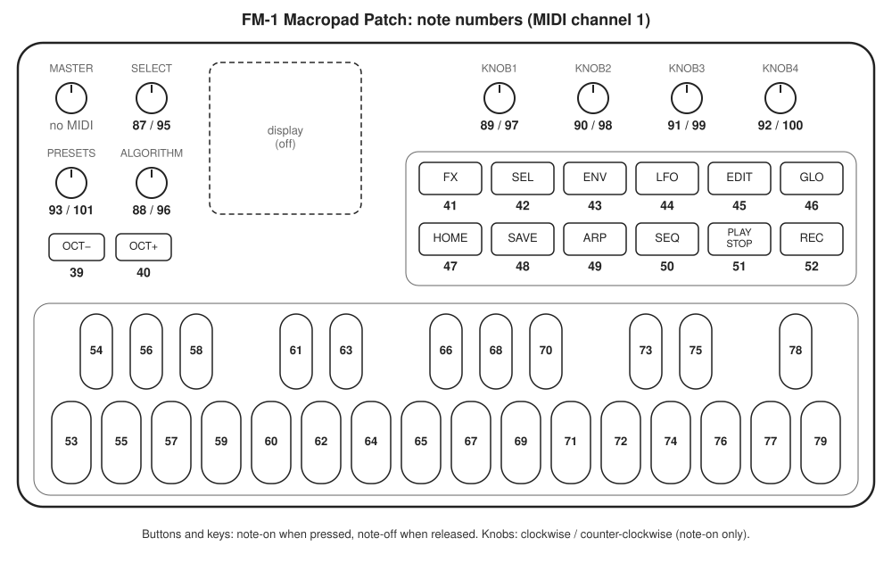

English | [日本語](README.ja.md)

# FM-1 Macropad Patch (unofficial)

An unofficial patch for the official M-VAVE FM-1 firmware V15.
It makes every button, key and knob send a USB-MIDI note.

The patch alone does not turn the FM-1 into a macro pad. The patch turns every input into MIDI,
and an app on your computer turns that MIDI into shortcuts. Together they let you use the FM-1 as a macro pad.

```
FM-1 buttons, keys, knobs ─(USB-MIDI notes)→ shortcut app ─→ shortcuts
          ↑ this patch                          ↑ Keyboard Maestro, BetterTouchTool, etc.
```

**This repository does not contain any M-VAVE firmware.** Download `FM-1.fwsc` (V15) from the official
website yourself and apply the patch locally.

> **Unofficial and not affiliated with M-VAVE.** This project is not endorsed or supported by M-VAVE.
> M-VAVE and FM-1 are trademarks or product names of their respective owners. **No M-VAVE firmware is included in this repository.**

> **Use at your own risk.** Flashing modified firmware may void your warranty.
> A failed update can, in the worst case, leave the unit unusable (no recovery method for this model is known).
> The software comes with no warranty, and the author is not liable for any damage arising from its use.
> Read the notes in [docs/FLASHING.md](docs/FLASHING.md) before flashing.

## What it does

| Input | Count | Note sent (channel 1) |
|---|---|---|
| Buttons | 14 | 39–52 |
| Keys | 27 | 53–79 (same as stock) |
| Knobs, clockwise | 7 | 87–93 |
| Knobs, counter-clockwise | 7 | 95–101 |

- 55 inputs in total. Buttons and keys send note-on when pressed and note-off when released. Knobs send a single note-on per detent.
- Note-on velocity follows the unit's own setting (1 on the author's unit). Note-off velocity is 100.
- The settings screen is no longer reachable after patching, so change the velocity setting with the official firmware before flashing if you need to.
- All LEDs stay off, and the display stays off.
- The unit still makes sound when you use it. The MASTER knob (volume) is left as is and sends no MIDI, so turn it down when using the FM-1 as a macro pad.
- Full mapping: [docs/NOTE_MAP.md](docs/NOTE_MAP.md)



## Apps for assigning shortcuts

The FM-1 only sends MIDI notes, so you need an app that receives them and turns them into shortcuts.

| App | OS | Price | Notes |
|---|---|---|---|
| [Keyboard Maestro](https://www.keyboardmaestro.com/) | macOS | Paid | MIDI note triggers |
| [BetterTouchTool](https://folivora.ai/) | macOS | Paid | MIDI note triggers |
| [MidiKey2Key](https://midikey2key.de/) | Windows | Free (donationware) | Turns MIDI input into keystrokes or launches programs |
| [Bome MIDI Translator Pro](https://www.bome.com/products/miditranslator) | Windows / macOS | Paid (trial available) | Advanced rules, logic and layers |

- See the table above and [docs/NOTE_MAP.md](docs/NOTE_MAP.md) for the note numbers.
- Whether a note-on with velocity 1 triggers an action depends on the app. Set triggers to accept any velocity.

## What you lose

- All synthesizer functions (patch selection and editing, sequencer, arpeggiator, etc.).
- Flash the official firmware to get them back ([docs/FLASHING.md](docs/FLASHING.md)).

## Requirements

- An M-VAVE FM-1
- Official firmware V15: `FM-1.fwsc` from the M-VAVE Downloads page
  - Only the file with SHA-256 `db1642b2b6fa5c2cccb11ffd13878068bb28601678d3644049f99dc40e7edb8a` is accepted. If M-VAVE replaces this file, the patcher will stop working.
- The official updater M-UPGRADE (Windows / macOS; the generic version on the M-VAVE Downloads page)
- To apply the patch: a web browser (Chrome, Edge, Safari, etc.) or Python 3.9 or later

## Usage

### 1. Apply the patch (browser, recommended)

1. Open the patcher page: <https://smememe.github.io/fm1-macropad-patch/>
2. Drop `FM-1.fwsc` onto the page, or click "choose a file"
3. When it shows "Official V15 firmware confirmed" and "All 16 patch sites match", click "Download FM-1-macropad.fwsc"

Everything runs inside your browser and the file is not uploaded anywhere (the page is configured to block all network requests).
You can also download this repository as a zip and double-click `docs/index.html`; it works the same way offline.

### 1'. Apply the patch (Python)

For those who want to read and check the source. Put `FM-1.fwsc` in the same folder as `fm1patch.py` and run this in that folder.
On Windows, use `py` instead of `python3`.

```bash
python3 fm1patch.py FM-1.fwsc -o FM-1-macropad.fwsc
```

Both methods check the SHA-256 of the official firmware and the original bytes at all 16 patch sites before writing anything.
If anything does not match, nothing is produced. The output always has SHA-256
`4192103baeef0b4601a60e0ec55cd517371ec9834ce2e6b2964647e22aa98641`.

### 2. Flash it

1. Start M-UPGRADE and connect the FM-1 over USB. Check that the unit is shown as FM-1 (its current firmware version does not matter).
2. Click "Select Firmware" and choose `FM-1-macropad.fwsc`. It should show "Firmware version:51".
3. Click "Update Firmware" and wait until it reports completion (about 20–60 seconds). The unit restarts by itself.
4. In your shortcut app (see "Apps for assigning shortcuts" above), assign a shortcut to one key and check that pressing it works.

When flashing from Windows in a virtual machine (e.g. Parallels), the unit reconnects as a different USB device during the update.
If you are asked where to connect it, choose Windows, and allow the connection if asked again.

## Reverting

Flash the official `FM-1.fwsc` with M-UPGRADE.

## Troubleshooting

- **The patcher stops with a SHA-256 mismatch**: the input is not the official V15 `FM-1.fwsc`. This also happens if M-VAVE replaces the file on their site; please report it in Issues.
- **M-UPGRADE does not find the unit**: reconnect the USB cable and restart M-UPGRADE. Close any other MIDI app that may be holding the device.
- **"A firmware that does not conform to the device was selected"**: no file is selected, or it is not an FM-1 file. Select the `.fwsc` made by the patcher again.
- **The update stopped halfway**: keep USB connected, power-cycle the unit, and try flashing again with M-UPGRADE (the author has not tested an interrupted update).
- **A shortcut does not fire**: use a MIDI monitor (an app that just lists incoming MIDI, e.g. [MIDI Monitor](https://www.snoize.com/midimonitor/) on macOS or [MIDI-OX](http://www.midiox.com/) on Windows) to check whether the unit sends notes.
  If it does, check your shortcut app (velocity conditions, etc.). If it does not, suspect the flashing or the connection.
- **Going back to stock**: flash the official `FM-1.fwsc` with M-UPGRADE.

## Support

Bug reports are welcome in [Issues](../../issues). This is a personal hobby project, so replies and fixes are not guaranteed.

## Tested environments

| Item | Details |
|---|---|
| Firmware | Official V15 (`FM-1_015`) |
| Flashing | M-UPGRADE for macOS (released 2026-09-08) / for Windows (Windows 11 on ARM in Parallels) |
| Verified | Flashing the patch, reverting to official (macOS), all 55 inputs, all LEDs off, reception in Keyboard Maestro |
| Patcher | Browser: Chromium-based, Safari (macOS), Edge (Windows 11), and a saved copy of the page; the output matched the expected result in each. Python: Python 3.14 on macOS |
| Not verified | Flashing from an x64 Windows PC, reverting from Windows |

## How it works

All changes are same-length, so the firmware size does not change. The patch rewrites 84 bytes at 16 sites in the app area,
changes the version string and one padding byte in the EQ name, then updates the checksums. See [docs/PATCHES.md](docs/PATCHES.md) and [docs/HOW_IT_WORKS.md](docs/HOW_IT_WORKS.md).

## For developers

- `fm1patch.py` holds the patch table. The browser patcher (`docs/index.html`) is built from `web/src/`:
  `python3 web/export_patches.py && python3 web/build_web.py`
- Tests need the official `FM-1.fwsc`: `FM1_FWSC=/path/to/FM-1.fwsc python3 tests/test_patch.py` and
  `node tests/test_web.cjs /path/to/FM-1.fwsc`

## Acknowledgements

- [AL-255/FM-1-RE](https://github.com/AL-255/FM-1-RE): analysis of the firmware structure and the update protocol. This work builds on it.
- [kagaimiq/jl-misctools](https://github.com/kagaimiq/jl-misctools): CRC and cipher routines for JieLi firmware containers (MIT; partly bundled in `jltech/`).

## License

- Code written by the author of this repository: [MIT License](LICENSE)
- Bundled third-party code: see [THIRD_PARTY.md](THIRD_PARTY.md)
- **The M-VAVE firmware, and the original byte sequences listed in [docs/PATCHES.md](docs/PATCHES.md) for verification, belong to M-VAVE (or their respective owners) and are not covered by the MIT License.**
- M-VAVE and FM-1 are trademarks or product names of their respective owners.
